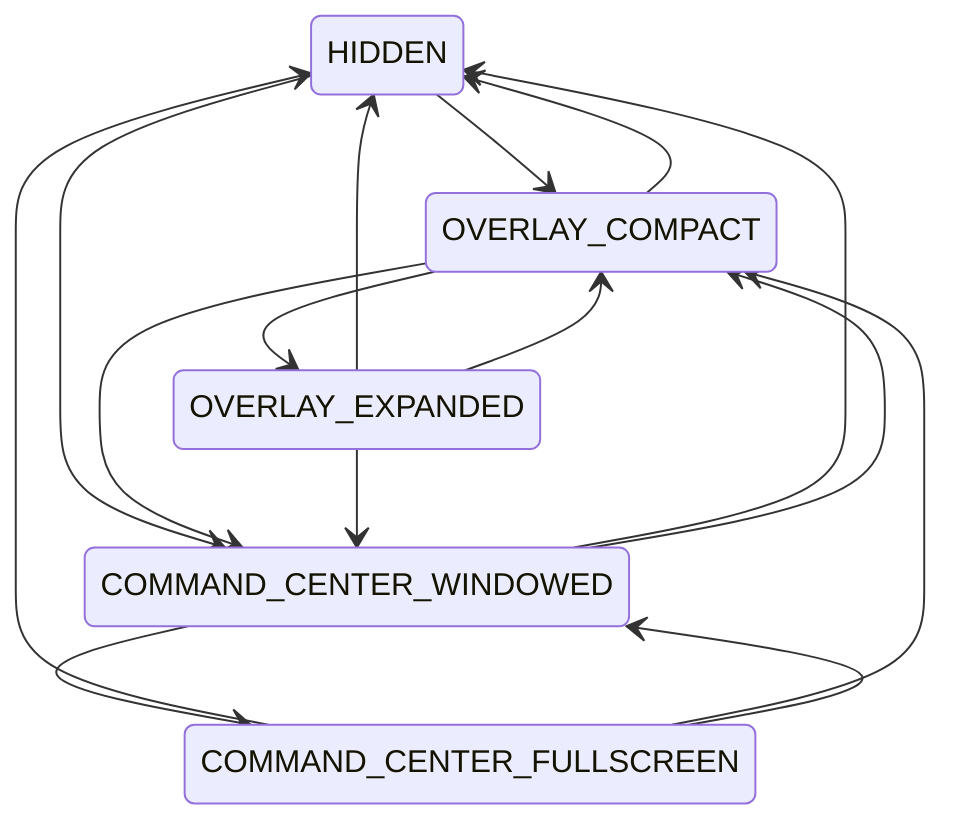

# Window state machine

Code: `desktop/src/mode-manager.js` (pure state machine), `desktop/src/window-state-store.js`
(pure persistence and bounds math), `desktop/src/main.js` (`requestMode`, `persist`,
`onDisplayChange`). Tests: `mode-manager.test.js` (MODES x MODES matrix against
`TRANSITIONS`), `window-state-store.test.js`, `bootstrap.test.js` (per-transition window
invariants and display-change recovery).

## States

| Mode | Overlay window | Command Center window |
|---|---|---|
| `HIDDEN` | hidden, click-through | hidden |
| `OVERLAY_COMPACT` | shown, 420x160 | hidden |
| `OVERLAY_EXPANDED` | shown, 420x520 | hidden |
| `COMMAND_CENTER_WINDOWED` | hidden, click-through | shown, ordinary frame |
| `COMMAND_CENTER_FULLSCREEN` | hidden, click-through | shown, native fullscreen |

Both overlay modes use the same `BrowserWindow`; only its size differs. A hidden overlay is a
hidden window, not an empty visible one, so it cannot intercept the mouse.

## Transitions

Same-mode requests are idempotent (they re-show the window). Everything not listed is rejected
by `requestMode` (returns `false`, nothing changes).



Rules: every mode reaches `HIDDEN` and `OVERLAY_COMPACT` directly; `HIDDEN` never starts straight
into the expanded overlay or fullscreen; fullscreen is entered only from `COMMAND_CENTER_WINDOWED`.

## Invariants

After every transition:

- The overlay is visible only in `OVERLAY_*`. Whenever it is not visible, its last
  `setIgnoreMouseEvents` call is `(true, { forward: true })`.
- The Command Center is visible only in `COMMAND_CENTER_*`, and fullscreen only in
  `COMMAND_CENTER_FULLSCREEN`.
- `HIDDEN` has no visible window.
- At most two windows exist (one per host); they are reused, never recreated.

## Concurrency

`beginTransition(target)` throws if a transition is already in flight. The mode becomes current,
and `onChange` listeners fire, only when the returned `settle()` runs. In `main.js`, `settle()` is
called after the other windows are hidden and the target window is created, and before it is
shown. If a step throws, `settle()` still runs and the app shuts down through `fail()`, so the
machine is never left mid-transition.

## Persistence

`app.getPath('userData')/window-state.json`, written atomically (tmp file + rename):

```json
{
  "initialMode": "OVERLAY_COMPACT",
  "overlay": { "displayId": 1, "x": 100, "y": 100, "width": 420, "height": 160 },
  "commandCenter": { "displayId": 1, "x": 100, "y": 80, "width": 1280, "height": 800, "maximized": false },
  "fullscreenPreference": false,
  "lastActiveWorkspace": "COMMAND_CENTER_WINDOWED",
  "launchAtLogin": false,
  "shortcuts": { "toggleOverlay": "Control+Alt+Shift+J", "toggleCommandCenter": "Control+Alt+Shift+C" }
}
```

`launchAtLogin` is boolean-only and defaults to `false` (opt-in; any non-boolean value reads as `false`).

`shortcuts` maps each action (`toggleOverlay`, `toggleCommandCenter`) to an accelerator, validated by
`desktop/src/shortcuts.js`: `+`-separated, modifiers `Control`/`Ctrl`/`CommandOrControl`/`Alt`/`Shift`
(canonical order Control, Alt, Shift), exactly one key `A-Z`, `0-9` or `F1-F24`, and at least two
modifiers (or one for a function key). `Super`/`Meta` is rejected to stay off Windows-key bindings.
Invalid, reserved or duplicate values fall back per action to the default and are reported as
`shortcutRejections` by `loadStateWithDiagnostics` (`reason`: `invalid`, `reserved`, `duplicate`).
The reserved list is Core's daemon hotkey `Control+Alt+J` (config.win.json) plus VS Code defaults
(`Control+Shift+` P/E/F/G/D/X/N/T); Windows system combos with named keys (Alt+Tab, Alt+F4,
Control+Alt+Delete, arrows) are unreachable by the key grammar.

`displayId` is the display with the largest work-area overlap (`screen.getDisplayMatching`, falling
back to `displayForBounds`). Command Center bounds are the normal bounds; nothing is captured while
the window is maximized, minimized or fullscreen.

## Restore algorithm

`resolveBounds(saved, displays, primary, defaults)` returns bounds plus a `reason`:

1. `restored`: the saved display exists and the saved bounds already fit its work area.
2. `clamped`: the saved display exists (or the bounds still overlap some display) and the bounds were
   moved or shrunk into that display's work area.
3. `display-missing`: a position or display was saved but is no longer visible. The window is
   centered on the primary display.
4. `default`: nothing was saved. Centered on the primary display at the default size.

Any reason other than `restored` logs `state-recovered`. The overlay is also re-clamped each time it
is shown, so expanding it near the bottom or right edge stays fully visible.

## Display-change recovery

`main.js` listens to `screen` events `display-removed`, `display-added` and
`display-metrics-changed`, and removes the listeners on quit. For each visible overlay and each
windowed Command Center it re-runs `resolveBounds`, applies `setBounds` only when the result differs,
persists it, and logs `display-change` with the repositioned hosts. A maximized or fullscreen Command
Center is touched only if its saved display disappeared: it returns to windowed (or is unmaximized)
and is then re-resolved. Failures go to `fail('display-change')`.

## Corrupt-file handling

`loadStateWithDiagnostics` never throws. An unreadable file, invalid JSON or a non-object root yields
defaults with `recovered: 'unreadable-file' | 'corrupt-file'`. Each field is sanitized individually, so
a hand-edited invalid `initialMode` falls back to `OVERLAY_COMPACT` with `recovered: 'invalid-initial-mode'`.
Bootstrap logs `state-recovered` and starts normally; it no longer fails on a bad persisted mode.

## Still BLOCKED

Automated tests drive these paths with fake displays. Not yet proven on physical hardware: a real
monitor unplug or replug, DPI or resolution change, and fullscreen on a removed display under the
Windows compositor. These need the dual-monitor host harness.

## Window-state restore acceptance

Run from WSL (uses `powershell.exe`, the real Windows Electron runtime, and a harness-owned userData directory with persistence active):

    node desktop/scripts/native-window-state.cjs

Each scenario launches the app (seed phase, then restore phase where a save is needed) and `windows-window-state-probe.py` independently records hwnd, `GetWindowRect`, monitor/work area and `IsZoomed`. It only moves its own owned hwnd and never changes display settings.

| Scenario | Meaning |
|---|---|
| persist-restore-secondary | Command Center moved to a non-primary monitor restores on the same monitor and bounds (BLOCKED `single-monitor` on one display) |
| offscreen-recovery | Seeded bounds on a nonexistent display come back inside a visible work area |
| resolution-shrink-clamp | Seeded oversized bounds are clamped into a work area |
| overlay-position-restore | Overlay restores its saved origin, and still works after expanding |
| maximized-restore | Maximized Command Center restores maximized |
| physical-display-change | Needs the owner to unplug or resize a monitor |

Latest run `desktop-native-window-state-run-7ZJLH8` (3 monitors, 2026-10-14): status PASS_WITH_GAPS. The five non-physical scenarios are PASS; `physical-display-change` is BLOCKED (`requires-owner-physical-display-change`). Cleanup left no remaining or errored processes. Earlier runs exposed two transient races (journal write sharing violation, reading a half-written response.json); both now retry, and five consecutive live runs passed.

Remaining BLOCKED: a physical disconnect or live resolution/DPI change needs owner participation (S08/S09).
